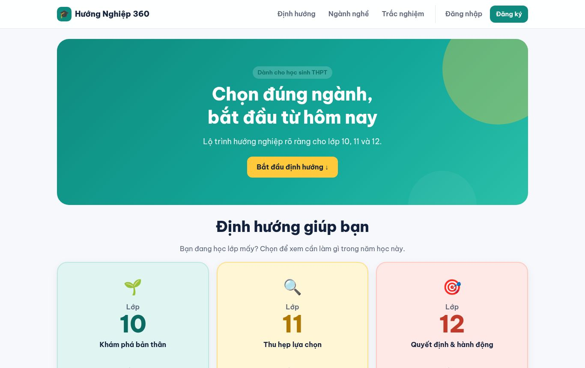
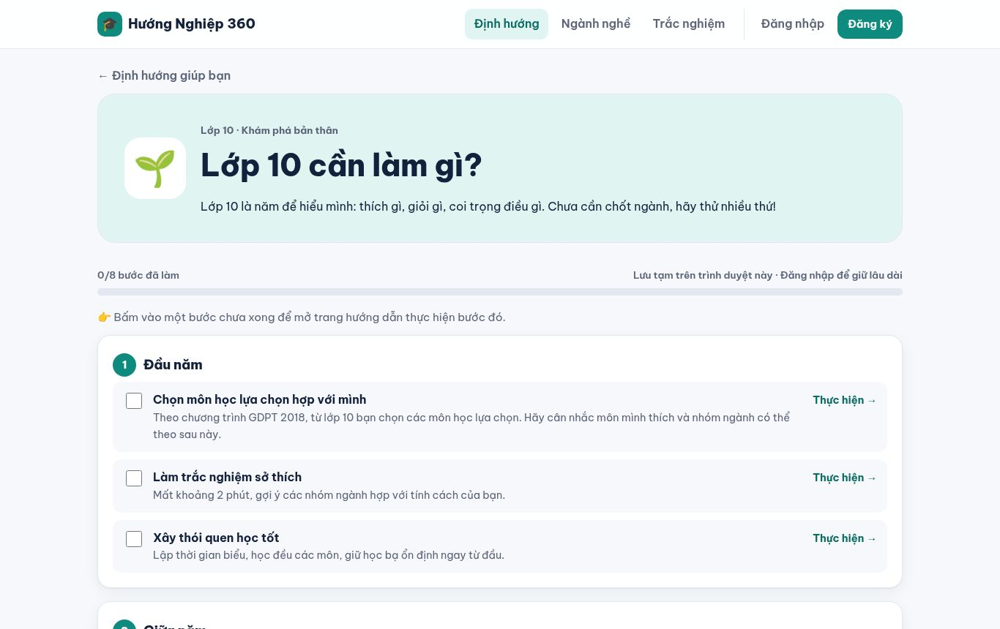
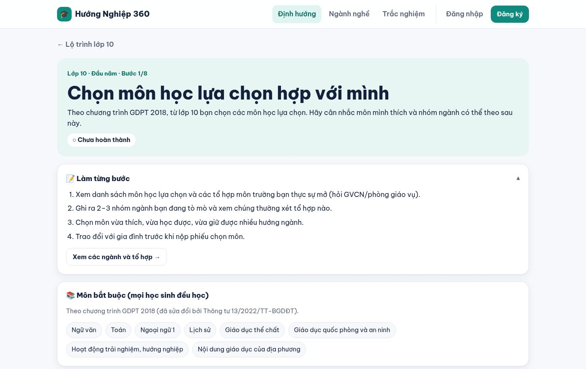
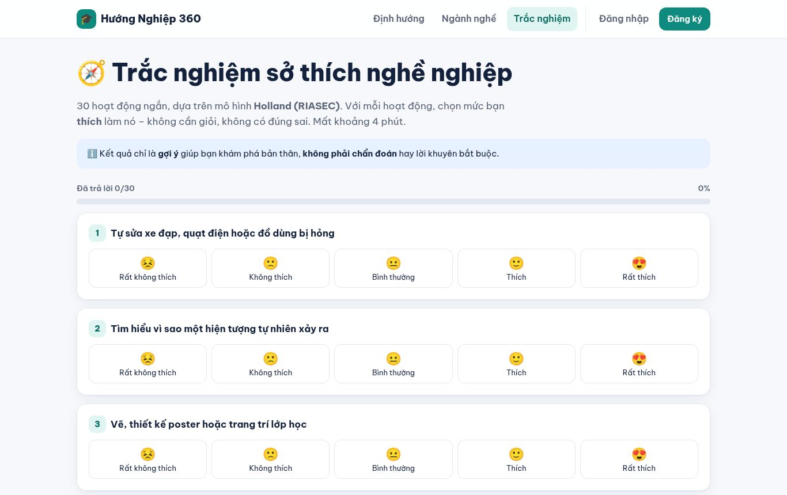

# Hướng Nghiệp 360

Web hướng nghiệp cho học sinh lớp 10–12 (Flask + SQLite, tiếng Việt).

**🌐 Bản chạy thử:** https://huong-nghiep-360.onrender.com (Render gói miễn phí: lần đầu mở có thể mất ~30 giây để khởi động)

**EN:** A Vietnamese career-guidance web app for high-school students (grades 10–12): a step-by-step checklist per grade (25 guided step pages), a 30-question Holland/RIASEC interest quiz with radar chart, major pages with sourced income data, side-by-side major comparison, and accounts that save quiz results and progress. Built with Flask, SQLite and vanilla JS, deployed on Render.

| Trang chủ | Lộ trình lớp 10 |
|---|---|
|  |  |
| **Trang con từng bước** | **Trắc nghiệm Holland** |
|  |  |

## Công nghệ
Python 3 · Flask · SQLite · Jinja2 · JavaScript thuần · Chart.js (tự lưu trữ) · Gunicorn · Docker · Render · phát triển theo hướng *vibe coding* (lập trình cùng AI).

## Chạy thử trên máy
```bash
python3 -m venv .venv && .venv/bin/pip install -r requirements.txt
.venv/bin/python app.py              # http://127.0.0.1:5000 (debug tắt)
.venv/bin/python test_app.py         # kiểm thử
```

## Tính năng
- Trang ngành (`/nganh/<id>`): thu nhập bình quân **ngành kinh tế liên quan** (Cục Thống kê, năm 2024; 2025 theo ngành chưa công bố), lương khởi điểm/thị trường khi có nguồn, dữ kiện nhu cầu có nguồn. Thiếu số liệu → ghi "chưa có số liệu – minh họa", không vẽ biểu đồ bịa.
- `/nguon-du-lieu`: toàn bộ nguồn, năm, cách quy đổi, độ phủ dữ liệu.
- `/quiz`: trắc nghiệm Holland/RIASEC 30 câu Likert 1–5 → điểm 0–100 mỗi nhóm, mã 3 chữ, radar, ngành phù hợp (mỗi ngành có mã `riasec`, độ khớp trọng số 3-2-1). Chỉ để tham khảo, không phải chẩn đoán.
- `/so-sanh?nganh=a&nganh=b[&nganh=c]`: so sánh 2–3 ngành; chọn bằng checkbox trên thẻ, thanh so sánh dính đáy (localStorage `hn360:compare`).
- `/lop-10|11|12`: checklist. Ô chưa tích → mở trang con `/lop-<g>/buoc/<lớp-giai đoạn-mục>` (hướng dẫn, ghi chép localStorage, nguồn chính thống, nút "Đánh dấu hoàn thành"/"sang bước tiếp"). Ô "Làm trắc nghiệm sở thích" → `/quiz?buoc=10-0-1`; nộp quiz tự tích ô và trang kết quả có nút "Tiếp tục bước tiếp theo". Tiến độ: đã đăng nhập → bảng `progress`; khách → session cookie (gộp vào tài khoản khi đăng nhập). `POST /api/tien-do` (JSON, header `X-CSRF-Token`).
- Số liệu: năm 2024–2025 (Cục Thống kê 2024/2025, Bộ GD&ĐT tuyển sinh 2025, TopCV/Navigos/JobOKO 2024–2025).
- `/con-duong-khac`: cao đẳng, trung cấp, vừa học vừa làm, du học, gap year, quân đội/công an + link chính thức.
- `/chinh-sach-bao-mat`: chính sách cho người dùng dưới 18 tuổi.

## Mô hình dữ liệu (SQLite, `DATA_DIR/app.db`)
| Bảng | Cột chính |
|---|---|
| users | id, username (unique, lower), password_hash (scrypt), full_name, school, created_at |
| profiles | user_id PK, grade, province, interests/strong_subjects/target_majors (JSON), combo, after_school, … |
| riasec_results | id, user_id, created_at, grade (lớp lúc làm), scores (JSON R..C 0–100), code (3 chữ), answered |
| progress | (user_id, grade) PK, done (JSON danh sách khóa bước `lớp-giai đoạn-mục`), updated_at |
| login_attempts | key (ip / ip+user), fails, first_at, locked_until — chống dò mật khẩu |
| quiz_results | bảng cũ (v3), giữ để tương thích |
Mọi bảng con `ON DELETE CASCADE` — xóa tài khoản xóa sạch dữ liệu.

`data/careers.json`: `sources{id:{name,url,year,note}}`, `gso_sectors{mã VSIC:{name,v:[2024] nghìn đồng}}`, `gso_all`, mỗi ngành: `gso_sector`, `riasec`, `salary_vnd{min,max,unit,note,source}` (tùy chọn), `facts[{text,source}]`.

## Bảo mật
CSRF cho mọi POST; CSP `script-src 'self'` (không có JS inline), font + Chart.js tự lưu trữ; cookie HttpOnly/SameSite=Lax/Secure; khóa đăng nhập sau 5 lần sai (theo IP+tài khoản) hoặc 30 lần (theo IP), thời gian tăng dần tới 15 phút; giới hạn request 64 KB; chặn mật khẩu phổ biến; chặn open-redirect.

## Triển khai
Biến môi trường:
| Biến | Ý nghĩa | Mặc định |
|---|---|---|
| `SECRET_KEY` | khóa ký phiên — **bắt buộc đặt trong production** | tự sinh, lưu `DATA_DIR/.secret_key` |
| `DATA_DIR` | thư mục chứa SQLite (cần ổ đĩa bền) | `data/` |
| `PORT` | cổng gunicorn | 5000 |
| `SESSION_COOKIE_SECURE` | đặt `1` khi chạy HTTPS (bật luôn HSTS) | `0` |
| `TRUST_PROXY` | `1` khi đứng sau reverse proxy (Render, Nginx) để lấy IP thật | `0` |
| `WEB_CONCURRENCY` | số worker | 2 |

Chạy production (không dùng server debug):
```bash
SECRET_KEY=$(python3 -c 'import secrets;print(secrets.token_hex(32))') \
  .venv/bin/gunicorn -c gunicorn.conf.py wsgi:app
```
- **Docker:** `docker build -t hn360 . && docker run -p 5000:5000 -e SECRET_KEY=... -v hn360data:/data hn360`
- **Render:** đẩy repo lên GitHub → New → Blueprint → chọn repo (`render.yaml` có sẵn, kèm disk 1 GB ở `/var/data`, health check `/healthz`).
- **Heroku/Railway:** dùng `Procfile`; lưu ý ổ đĩa tạm thời sẽ mất SQLite khi khởi động lại — cần volume.
Trên HTTPS nhớ đặt `SESSION_COOKIE_SECURE=1` (render.yaml đã đặt sẵn).

## Giới hạn
- Một số số liệu ngành là minh họa/chưa đầy đủ: trang nào thiếu nguồn sẽ ghi "chưa có số liệu – minh họa". Kiểm tra lại với nguồn gốc trước khi dùng cho quyết định thật.
- Bản chạy thử dùng Render gói miễn phí: không có ổ đĩa bền, nên **tài khoản và dữ liệu bị xóa mỗi lần triển khai lại hoặc khởi động lại**; máy ngủ khi không có truy cập (~30 giây để thức dậy). `render.yaml` mô tả cấu hình có ổ đĩa (gói trả phí).
- Nội dung về chương trình GDPT 2018 / Thông tư 13/2022/TT-BGDĐT chưa được đối chiếu với văn bản gốc.
- Trắc nghiệm Holland chỉ để tham khảo, không phải công cụ chẩn đoán.
